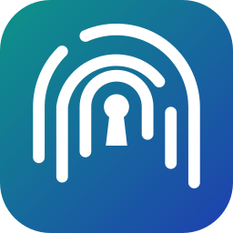

<p align="center">
  
</p>

# pyzkaccess-native

**Talk to ZKTeco access-control devices from any OS, in pure Python. No DLL, no Windows,
no ZKAccess.**

[](https://pypi.org/project/pyzkaccess-native/)
[](https://pypi.org/project/pyzkaccess-native/)
[](https://github.com/Avataar120/pyzkaccess/actions/workflows/ci.yml)
[](https://hacs.xyz/)
[](LICENSE)

ZKTeco panels and readers that are managed by **ZKAccess** (C3-100/200/400, inBio,
MA500...) speak a binary TCP protocol. The only official way to use it is the PullSDK
(`plcommpro.dll`), a 32-bit Windows DLL. This project reimplements that protocol from
scratch, from captures of the DLL's own traffic, so you can:

- read and manage **users, RFID cards, keypad codes and fingerprint templates**;
- grant and revoke **door access**;
- receive **access events in real time** (who opened which door, refused attempts...);
- **open doors**, drive auxiliary outputs, set the clock, read and write parameters;
- **back up and restore** a whole device, fingerprint templates included, byte for byte;

from Linux, macOS, Windows, a Raspberry Pi or a container, with no dependency at all.

It comes with:

| | |
|---|---|
| 🐍 **Python library** | `pip install pyzkaccess-native` |
| 💻 **Command line tool** | `zkaccess --host 192.168.1.201 users` |
| 🏠 **Home Assistant integration** | installable from HACS, with a management page in the sidebar, see [below](#home-assistant-integration) |
| 🧪 **Device emulator** | test your code without hardware |
| 📖 **Protocol documentation** | [docs/PROTOCOL.md](docs/PROTOCOL.md) |

> [!NOTE]
> Not to be confused with [`pyzkaccess`](https://github.com/bdragon300/pyzkaccess), a
> different project that wraps the official Windows DLL. This one does not need the DLL.

---

## Contents

- [Supported devices](#supported-devices)
- [Installation](#installation)
- [Quick start](#quick-start)
- [Library guide](#library-guide)
- [Command line tool](#command-line-tool)
- [Home Assistant integration](#home-assistant-integration)
- [Safety notes (read this)](#safety-notes-read-this)
- [Testing without hardware](#testing-without-hardware)
- [Troubleshooting](#troubleshooting)
- [Contributing](#contributing)

## Supported devices

Any device that ZKAccess / the PullSDK can manage *should* work, since they share the
protocol.

| Device | Status |
|---|---|
| **MA500** (fingerprint + RFID reader), firmware 6.64 | ✅ tested (reboot and normal-open state excepted) |
| C3-100 / C3-200 / C3-400 | 🟡 expected to work (same protocol); please report |
| inBio 160/260/460 | 🟡 expected to work; please report |
| Push-protocol / "standalone attendance" devices (`pyzk`, port 4370 UDP) | ❌ different protocol |

If you try another model, please open an issue with the output of `zkaccess info` and
`zkaccess tables`: it helps a lot.

## Installation

```bash
pip install pyzkaccess-native
```

Python 3.10 or newer, no other dependency.

## Quick start

```python
from pyzkaccess_native import ZKAccess

with ZKAccess("192.168.1.201") as dev:          # password="..." if one is set
    info = dev.info()
    print(info.serial_number, info.firmware)

    for user in dev.get_users():
        print(user.user_id, user.name, user.card_no)

    for event in dev.events():                  # Ctrl+C to stop
        print(event.time, event.user_id, event.label, "granted" if event.granted else "")
```

From a shell:

```bash
zkaccess --host 192.168.1.201 info
zkaccess --host 192.168.1.201 events
```

## Library guide

### Connecting

```python
from pyzkaccess_native import ZKAccess

dev = ZKAccess("192.168.1.201", port=4370, password="", timeout=5.0)
dev.connect()
...
dev.disconnect()
```

Or, better, `with ZKAccess(...) as dev:`. The client is thread-safe: requests from
several threads are serialized on its session.

> [!IMPORTANT]
> Share one `ZKAccess` instance inside your program. A device may accept a second
> session (the MA500 does), but **real-time events are delivered to every session**, and
> writes from two programs are not coordinated. Do not manage the same device from
> ZKAccess and from this library at the same time.

### Device information, parameters and clock

```python
info = dev.info()            # DeviceInfo(serial_number, firmware, lock_count, ...)
dev.get_params(["~SerialNumber", "Door1Drivertime", "MThreshold"])
dev.set_params({"Door1Drivertime": 5})

dev.get_time()               # naive datetime, device local time
dev.set_time()               # sync with this computer (or pass a datetime)
```

### Users

> **Vocabulary.** A user is identified by its **UserID**, the number typed on the keypad
> (stored by the device in a field called `Pin`). The device also gives each user an internal
> **slot** (field `UID`) that binds fingerprint templates to their owner; it cannot be chosen.

```python
from pyzkaccess_native import User

dev.get_users()                                  # list[User]
dev.get_user(105)                                # User | None

# Create, or update only the given fields (the others are kept):
dev.save_user(User(user_id=105, name="Alice", card_no=12345678, password="1234"))
dev.save_user(User(user_id=105, name="Alice Smith"))  # rename, card and password kept

dev.delete_user(105)       # also deletes its fingerprint templates and authorizations
```

`User` fields: `user_id`, `name`, `card_no`, `password` (keypad code), `group`, `start_time`,
`end_time`, `privilege`, `super_authorize`, and `slot` (read-only, see below).

### Door access

```python
dev.grant(105)                               # time zone 1 ("always"), door 1
dev.grant(105, timezone_id=2, door_mask=0b0101)   # doors 1 and 3 during time zone 2
dev.get_authorizations(105)                  # list[Authorization]
dev.revoke(105)                              # remove all of them
```

A user can open a door only if they have an authorization for it **and** a credential
(fingerprint, card or password).

### Fingerprint templates

Fingerprints are enrolled **on the device** (keypad menu or ZKAccess with a USB reader).
The library can copy, back up and restore the resulting templates:

```python
from pyzkaccess_native import Template

templates = dev.get_templates()          # all of them (large transfer handled for you)
mine = dev.get_templates(user_id=105)

# Copy a template to another device (the user must exist there):
other.save_user(User(user_id=105, name="Alice"))
other.save_template(Template(user_id=105, finger_id=0, template=mine[0].template))

dev.delete_templates(105)                # or delete_templates(105, finger_id=3)
dev.move_template(105, 3, 100)           # one finger to another user (first free slot)
dev.move_templates(105, 100)             # all fingers of 105 to 100, in one go
```

`save_template()` refuses to write when another user has the same internal slot (see
[safety notes](#safety-notes-read-this)).

### Real-time events

```python
from pyzkaccess_native import AccessEvent, EventType

for ev in dev.events(interval=0.5):      # reconnects automatically
    if ev.granted:
        print(f"{ev.user_id} opened door {ev.door} ({ev.label})")
    elif ev.event == EventType.UNREGISTERED_FINGERPRINT:
        print("unknown finger")
```

Or poll yourself: `dev.poll()` returns the records received since the previous call:
`AccessEvent` objects, plus a `DoorStatus` (door sensors, alarms) on every call.

`AccessEvent` has `event` (an `EventType`, or a plain `int` for unlisted codes), `user_id`,
`card`, `door`, `verify_mode`, `in_out`, `time`, plus the helpers `granted`, `denied` and
`label`.

### Doors and outputs

```python
dev.open_door(1, seconds=5)    # pulse the lock relay of door 1
dev.hold_door_open(1)          # until close_door()
dev.close_door(1)
dev.set_aux_output(1, 3)       # aux output 1 for 3 s (0 = off, 255 = on)
dev.cancel_alarm()
dev.restart()
```

### Generic table access

Everything above is built on four generic calls. They work on any table the device
reports (`dev.tables()`), with the device's own field names:

```python
dev.read_table("transaction", where={"Pin": 105})          # list[dict]
dev.read_table("user", fields=["Pin", "Name"])
dev.write_records("timezone", [{"TimezoneId": 2, "MonTime1": ...}])
dev.delete_records("holiday", where={"Holiday": 20261225})
dev.count("user")
```

### Backup and restore

```python
from pyzkaccess_native import backup

snap = backup.backup(dev)             # users, templates, authorizations, time zones...
backup.save(snap, "device.json")

backup.restore(dev, backup.load("device.json"))             # merge
backup.restore(dev, backup.load("device.json"), wipe=True)  # exact copy
```

> [!WARNING]
> Backups contain **biometric data** (fingerprint templates) and user passwords.
> Store them like any other secret.

### Discovery

```python
from pyzkaccess_native import discover
discover()     # UDP broadcast; only finds devices on the same subnet
```

### Errors

All exceptions derive from `ZKError`: `ZKConnectionError` (network),
`DeviceError` (the device refused, `.code` = -14 for a wrong password...),
`ProtocolError` (unexpected answer), `SafetyError` (refused by a safety check).

## Command line tool

```text
zkaccess [--host HOST] [--port 4370] [--password PWD] [-v|-vv] <command>
```

`--host` and `--password` can also come from `ZKACCESS_HOST` / `ZKACCESS_PASSWORD`.

| Command | Description |
|---|---|
| `discover` | find devices on the local network |
| `info` | serial number, firmware, doors, readers... |
| `tables` | tables and fields supported by the device |
| `params NAME... / NAME=VALUE...` | read / write parameters |
| `time [--set [ISO date]]` | read, or set the clock (default: now) |
| `users [--json]` | list users |
| `user-set USERID [--name] [--card] [--user-password]` | create or update a user (`--user-password` = keypad code) |
| `user-delete USERID [--yes]` | delete a user, its templates and authorizations |
| `grant USERID [--timezone 1] [--doors 1]` / `revoke USERID` | door access |
| `read TABLE [--where F=V] [--fields a,b] [--json]` | dump any table |
| `count TABLE` | number of records |
| `events [--status] [--json]` | live events, Ctrl+C to stop |
| `door open\|close\|hold [--door 1] [--seconds 5]` | drive a lock relay |
| `aux OUTPUT SECONDS` | drive an auxiliary output |
| `backup FILE [--logs]` / `restore FILE [--wipe] [--yes]` | full backup / restore |
| `cancel-alarm`, `restart` | |

`-vv` prints every frame in hex, handy for protocol work. `python -m pyzkaccess_native`
works too.

Example:

```console
$ export ZKACCESS_HOST=192.168.1.201
$ zkaccess users
UserID  Name   Card      Code  Slot
101     Alice  12345678  yes   1
$ zkaccess events
2026-11-21 08:02:11  door 1  user 101   card 0          14 Fingerprint open
2026-11-21 08:05:40  door 1  user 0     card 0          34 Unregistered fingerprint
```

## Home Assistant integration

The repository is also a **HACS** custom integration built on the library. It adds an
**Access control** page to the sidebar (administrators only) to manage people, fingerprints,
cards and codes without any YAML.

### Install

1. HACS → ⋮ → **Custom repositories** → add `https://github.com/Avataar120/pyzkaccess`,
   type **Integration**.
2. Install **ZKAccess Native** and restart Home Assistant.
3. **Settings → Devices & services → Add integration → ZKAccess Native**, enter the IP
   address (and the communication password, if any).
4. Open **Access control** in the sidebar.

### People and action categories

Access events only tell *which UserID* was recognized, never which finger or card. To let one
person trigger different actions (open the door, arm the alarm, open the garage...), each
person gets one UserID per **action category**:

```
UserID = person number (2 digits) followed by the category digit
person 12 + category 0 (Open)  -> UserID 120
person 12 + category 3 (Arm)   -> UserID 123
```

- Category **0 is always "Open"**. Digits 1-9 are free: standard types (Close, Lock,
  Unlock, Arm, Disarm) or custom names (Garage...), set in **Settings**.
- Each UserID holds **several fingerprints, one card and one keypad code**. A person can have
  two fingers that open and a third one that arms the alarm, or one card to open and
  another one to close.
- On the keypad, the code is typed after the UserID, so a person can reuse the same code in
  every category.
- Each category says whether it **triggers the device relay**. "Open" does; an "Arm" finger
  usually should not open the door: the device then refuses it (event 23 with the UserID,
  verified on the MA500), and the integration turns that refusal into an `action` event for
  Home Assistant.
- **Second presentation** (per category): presenting the same card or finger again within a
  few seconds runs a second category *in addition*. Example: badge once to open the gate,
  twice to open the gate and then lock and arm the house.

- **Toggle** categories: one presentation, and Home Assistant picks the category from the state
  of an entity (e.g. alarm armed → *Disarm*, otherwise → *Arm*). Active means anything but
  `off`, `unlocked`, `disarmed`, `closed`, `not_home`, `idle`, `unavailable`, `unknown`.

Prefer one UserID per person, without categories? Choose **One UserID per person** in
**Settings → Numbering**.

### Phones (NFC tags)

A phone running the Home Assistant app can act as a badge:

1. Create a tag in Home Assistant (**Settings → Tags**), stick it next to the door, and declare
   it in **Access control → Settings → NFC tags** with the door it stands for.
2. On a person's page, **Pair a phone**: the next phone that scans a declared tag within two
   minutes is paired with that person, in the chosen category.
3. A scan then produces the same `zkaccess_native_access` event as a fingerprint or a card
   (`method: phone`, `phone: <device name>`), with second presentation (scan twice) and toggle
   categories. If the category drives the relay, the integration releases the door itself.

Disabling a person also disables their phones; each phone can also be disabled on its own.

### The Access control page

| Tab | What you can do |
|---|---|
| **People** | list, search, create; per person: a two-hand view of enrolled fingers with their category, move a finger to another category, delete it; cards and codes per category; paired phones; enable / disable all access (rights are remembered and restored); link to a Home Assistant person; delete. UserIDs that do not follow the numbering (e.g. enrolled on the keypad) are listed as **Unassigned** and can be attached to a person. |
| **Activity** | live log with names, category, method (fingerprint, card, code, remote) and second presentations; filters; unknown cards can be assigned in one click |
| **Door** | open / hold open / close the lock relay; door settings written to the device (relay time, door sensor, open-door alarm delay, verification mode, free-passage time zone, relock on close); device clock; cancel alarm |
| **Settings** | numbering, action categories (incl. toggle), second-presentation delay, NFC tags for phones, automatic backups (on every change, nightly, retention), download / restore / import, keypad notifications |

**Enrolling a fingerprint.** Fingerprints are captured by the device itself (there is no
remote enrollment command). Click a free finger on the hand, pick its category: the page
shows the exact keys to type on the device keypad (`* #`, admin code, `3`, the UserID, `#`)
and detects the new fingerprint by itself. The page creates the UserID first, so the keypad
menu is `3` (backup fingerprint, adds a finger to an existing user); menu `1` (add user)
refuses an existing UserID. A UserID can hold several fingers: enroll them one after the
other with menu `3`.

**Identifying a finger.** The device reports which UserID recognized a finger, not which
of its fingerprints. *Identify a finger* (on a person, or from a free finger: *Already
enrolled? Identify it on the reader*) uses the reader as a sensor: place a finger and the
page shows the person, the UserID and the fingerprint slot, places it on the hand when a
finger was chosen, and offers to delete it. While identifying, the reader's events run no
automation and are not logged (it stops after 60 s without a finger). When the UserID has
several fingerprints, they are separated for a moment: each is copied to a temporary
UserID without rights (9990-9999), the UserID's own copies are removed, and the page asks
for the same finger again; then everything is put back and checked. The isolation is
recorded first, so a restart or an error puts the fingerprints back as well. No backup is
taken meanwhile. The device may still drive its own lock output for a recognized finger.

**Learning a card.** Click *Learn a card* and present the card: the device reports it as
unknown, the page shows its number and writes it to the chosen person and category.

### Entities

| Entity | Description |
|---|---|
| `event.<device>_access` | fires `granted`, `action`, `denied` or `other` (attributes below) |
| `binary_sensor.<device>_door_N` | door contact (unknown when no sensor is wired) |
| `binary_sensor.<device>_door_N_alarm` | alarm / door open too long |
| `sensor.<device>_last_person` | name of the last person let in or who triggered an action |
| `sensor.<device>_people`, `_fingerprints`, `_cards` | counters |
| `button.<device>_open_door_N` | pulse the lock relay |
| `button.<device>_sync_clock` | set the device clock |
| `binary_sensor.<device>_connected` | device reachable (stays available, so you can alert on it) |
| `sensor.<device>_clock_offset` | device clock drift before the last sync, in seconds |

Every access event is also fired on the bus as **`zkaccess_native_access`** with:

| Field | Example | Meaning |
|---|---|---|
| `result` | `granted` | `granted` (door released), `action` (known credential of a category without relay), `denied`, `other` |
| `person`, `person_name` | `12`, `Alice` | the person (with the "person + category" numbering) |
| `ha_person` | `person.alice` | linked Home Assistant person, if any |
| `category`, `category_digit`, `category_type` | `Arm`, `3`, `arm` | the action category |
| `gesture` | `single` / `double` | `double` = second presentation |
| `method` | `fingerprint` | `fingerprint`, `card`, `code`, `phone`, `remote`, `other` |
| `toggle` | `true` | the category was chosen by a toggle |
| `phone` | `Pixel 9` | name of the phone (phone access only) |
| `user_id`, `card`, `door`, `event`, `event_name`, `time`, `device_id` | | raw details |

Actions: `zkaccess_native.set_user`, `delete_user`, `grant`, `revoke`, `open_door`,
`sync_clock`, `list_users` (returns the users) and `backup`.

Options: polling interval (default 1 s), door open duration, clock sync on connection.
The device clock is also synced every night at 04:00.

**Diagnostics** can be downloaded from the device page (personal data, card numbers, names
and addresses are removed).

### Example automations

Run the right action for each category:

```yaml
automation:
  - alias: "Front door - actions"
    triggers:
      - trigger: event
        event_type: zkaccess_native_access
    conditions:
      - "{{ trigger.event.data.result in ['granted', 'action'] }}"
    actions:
      - choose:
          - conditions: "{{ trigger.event.data.category_type == 'open' }}"
            sequence:
              - action: lock.unlock
                target: { entity_id: lock.front_door }
          - conditions: "{{ trigger.event.data.category_type == 'arm' }}"
            sequence:
              - action: alarm_control_panel.alarm_arm_away
                target: { entity_id: alarm_control_panel.home }
          - conditions: "{{ trigger.event.data.category == 'Garage' }}"
            sequence:
              - action: cover.toggle
                target: { entity_id: cover.garage }
```

Notify on refused attempts:

```yaml
automation:
  - alias: "Front door - refused"
    triggers:
      - trigger: event
        event_type: zkaccess_native_access
        event_data:
          result: denied
    actions:
      - action: notify.mobile_app_phone
        data:
          message: "Refused at the front door: {{ trigger.event.data.event_name }}"
```

More in [examples/](examples/).

## Safety notes (read this)

Lessons learned the hard way while reverse-engineering. The library protects you
against each of them, but you should know them:

1. **Writing a user replaces the whole record.** Sending only a new name erases the
   password and the card number. → `save_user()` reads the record and merges first.
2. **Deleting without a condition erases the whole table.** → `delete_records()` refuses
   unless you pass `allow_wipe=True`.
3. **Some firmware give a new user an internal slot that another user already has.**
   Templates are bound to that slot, so a template written then could identify the wrong person.
   → `save_template()` checks for duplicates and refuses.
4. **Deleting a user does not delete its templates or its door rights.**
   → `delete_user()` cascades by default.
5. **ZKAccess "Add device" with "Clear data in device" checked erases the device**, even
   when it then fails with *"Unknown Device Model"*. Back up first
   (`zkaccess backup device.json`).
6. ZKAccess does not read door authorizations from the device: syncing its database back
   to the device can leave users without access.
7. Events are delivered to every open session: if two programs act on events, both will
   act. Do not manage a device from ZKAccess and this library at the same time.
8. **Some firmware ignore a delete with several conditions** (the MA500 answers OK to
   `Pin` + `FingerID` and removes nothing). → `delete_templates(user, finger_id)` and
   `move_template()` delete by `Pin` only and write the other fingers back.

## Testing without hardware

An emulator speaking the same protocol is included:

```bash
python -m pyzkaccess_native.emulator --port 4370 &
zkaccess --host 127.0.0.1 user-set 1 --name Test
zkaccess --host 127.0.0.1 users
```

In tests:

```python
from pyzkaccess_native import ZKAccess
from pyzkaccess_native.emulator import Emulator

def test_something():
    with Emulator() as emu, ZKAccess("127.0.0.1", emu.port) as dev:
        emu.state.push_event(14, user_id=1)        # simulate a fingerprint
        assert dev.poll()[0].user_id == 1
```

The emulator reproduces the behaviour observed on real devices (whole-record writes,
device-assigned slots, buffered transfers...), but the real device remains the reference.

## Troubleshooting

| Symptom | Cause / fix |
|---|---|
| `cannot connect` / timeout | wrong IP, device on another VLAN without routing, firewall, or a firmware that accepts a single session while another program is connected. |
| `device error -14` | wrong communication password (`ComPwd`). |
| `device error -13` | command not supported by this firmware. |
| no event received | check the polling loop is running; time zone / authorization of the user (event 23 = access denied). |
| `discover()` finds nothing | broadcasts do not cross routers; connect by IP. |
| clock drifts | call `set_time()` daily (the integration does it on each connection). |

Run with `-vv` (CLI) or `logging.getLogger("pyzkaccess_native").setLevel("DEBUG")` to see
every frame.

## Contributing

Issues and pull requests are welcome, especially:

- reports from other devices (`zkaccess info`, `zkaccess tables`);
- captures of PullSDK calls that are not documented yet (see the open questions at the
  end of [docs/PROTOCOL.md](docs/PROTOCOL.md)).

```bash
git clone https://github.com/Avataar120/pyzkaccess && cd pyzkaccess
pip install -e ".[test]"
pytest
```

Please never attach real fingerprint templates, passwords or card numbers to an issue.

### Releasing (maintainers)

1. Bump the version in `src/pyzkaccess_native/__init__.py`, and both `version` and the
   `pyzkaccess-native==` requirement in `custom_components/zkaccess_native/manifest.json`.
2. Update `CHANGELOG.md`, commit, then create a GitHub release with tag `vX.Y.Z`.
3. The `Publish to PyPI` workflow builds and uploads the package (PyPI trusted
   publishing, environment `pypi`; no token in the repository). HACS picks up the release.

## Legal

This is an independent project, not affiliated with or endorsed by ZKTeco. "ZKTeco" and
"ZKAccess" are trademarks of their owners. The protocol was documented by observing the
network traffic of software and devices legitimately owned by the author, for
interoperability purposes. Released under the [MIT license](LICENSE).
